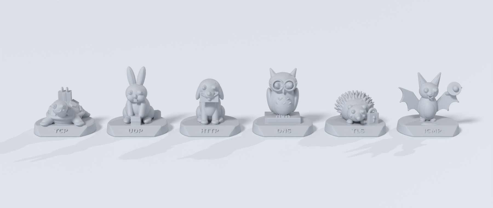

# Сетевые протоколы в виде животных — фигурки для 3D-печати


Шесть фигурок на подставках с выпуклой подписью. Модели сделаны в Blender 5.2
скриптом [`build_figures.py`](build_figures.py), то есть сцену можно пересобрать и поменять.

| Протокол | Животное | Почему | Модель |
|---|---|---|---|
| **TCP** | Черепаха | Медленно, зато надёжно: везёт на панцире посылку, перевязанную лентой, и всё доставит | [`tcp_turtle.stl`](stl/tcp_turtle.stl) |
| **UDP** | Кролик | Быстро и без рукопожатий: один пакет держит, второй уже обронил и не переспрашивает | [`udp_rabbit.stl`](stl/udp_rabbit.stl) |
| **HTTP** | Пёс | Запрос GET, и он приносит ответ: конверт в зубах | [`http_dog.stl`](stl/http_dog.stl) |
| **DNS** | Сова | Мудрая, знает адрес любого имени: сидит на толстой телефонной книге, в очках | [`dns_owl.stl`](stl/dns_owl.stl) |
| **TLS** | Ёж | Защищён со всех сторон: колючки и замок в лапке | [`tls_hedgehog.stl`](stl/tls_hedgehog.stl) |
| **ICMP** | Летучая мышь | Ping: эхолокация (волны на подставке), а в руке ракетка для пинг-понга | [`icmp_bat.stl`](stl/icmp_bat.stl) |

| | | |
|---|---|---|
|  |  |  |
|  |  |  |

Так выглядят сетки для печати (одноцветные, как выйдут из принтера):



## Файлы

- `stl/*.stl`: готовые модели. Единицы — **миллиметры**, фигурка уже стоит на столе (z = 0), ставить в слайсер как есть.
- `protocol_animals.blend`: сцена Blender. В коллекциях `… — цвет` лежат цветные детали
  (их удобно править), в коллекциях `… — печать` — итоговые сетки для печати.
- `renders/`: превью. `*_print.png` — та же модель, что в STL.

## Размеры

Все подставки 54 × 48 мм и высотой 8 мм. У черепахи хвост выступает за подставку на 2 мм.

| Фигурка | Высота | Объём пластика* |
|---|---|---|
| TCP — черепаха | 38 мм | 31 см³ |
| UDP — кролик | 57 мм | 29 см³ |
| HTTP — пёс | 47,5 мм | 29 см³ |
| DNS — сова | 55 мм | 34 см³ |
| TLS — ёж | 34 мм | 29 см³ |
| ICMP — летучая мышь | 51 мм (крылья 56 мм в размахе) | 23 см³ |

\* Это объём сплошной модели. При заполнении 15 % на фигурку уйдёт примерно 12–18 г PLA.

Нужен другой размер — масштабируйте в слайсере: при 150 % получится около 8 см в высоту.
Уменьшать меньше чем до 80 % не стоит, иначе потеряются зрачки и надписи.

## Проверка сеток

Каждая модель — одна замкнутая оболочка (watertight, manifold): 0 открытых
и 0 неманифолдных рёбер, без внутренних полостей и отдельных кусочков.
Детали объединены воксельным ремешем с шагом 0,22 мм, около 220 тыс. треугольников на фигурку.
Скрипт сам проверяет это при сборке и выводит отчёт.

## Как печатать

**FDM (PLA/PETG), сопло 0,4 мм:**
- слой 0,12–0,16 мм (так глаза и надписи получатся аккуратнее);
- 2–3 периметра, заполнение 10–15 %;
- **поддержки — древовидные (tree), только от стола.** Они нужны под головой черепахи,
  ушами и подбородком пса, конвертом, крыльями и ракеткой летучей мыши. Кролику, сове и ежу
  поддержки почти не нужны;
- надпись на скошенной передней грани подставки печатается без поддержек.

**Фотополимер (SLA/MSLA):** сделайте модель полой (стенка 2 мм) с отверстием в дне,
наклоните на 20–30° и поставьте лёгкие поддержки. Детали выйдут лучше всего.

**В несколько цветов:** проще всего раскрасить акриловыми красками после печати,
ориентируйтесь на цветные превью. На FDM-принтере со сменой цвета можно поставить
паузу на высоте 8 мм: тогда подставка и надпись будут одного цвета, а животное другого.

## Пересборка и правка

```bash
pip install bpy            # или используйте установленный Blender 4.2+
python3 build_figures.py   # всё: STL + .blend + превью (~8 мин на 4 ядрах)
python3 build_figures.py --no-render            # только STL и .blend (~1 мин)
python3 build_figures.py --only TCP,DNS         # только выбранные фигурки
blender -b -P build_figures.py -- --no-render   # то же через Blender
```

Каждое животное описано своей функцией (`tcp_turtle()`, `udp_rabbit()` …) из простых
форм: эллипсоидов, «конечностей» между двумя точками, торов, коробок. Размеры в мм.
Чтобы добавить протокол, напишите функцию и добавьте строку в список `FIGURES`.
Например, так: SSH — бобёр со связкой ключей, FTP — верблюд с грузом файлов,
BGP — почтовый голубь с картой маршрутов.
